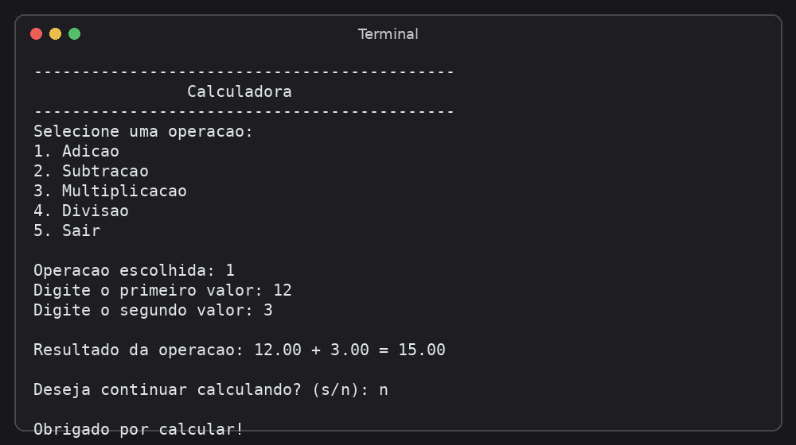

# Calculadora em C

Uma calculadora interativa de terminal desenvolvida em linguagem C. O programa permite realizar operações básicas — adição, subtração, multiplicação e divisão — com números reais, repetir cálculos e encerrar pelo menu. É útil para praticar fundamentos de C, como entrada e saída, decisões, laços e validação de dados.

## Demonstração

A imagem abaixo ilustra uma execução da calculadora no terminal.



## Pré-requisitos

- Um compilador C compatível com o padrão usado pelo código, como o GCC.
- Um terminal para executar o programa.

Não são necessárias bibliotecas externas: o código utiliza bibliotecas padrão da linguagem C.

## Instalação e compilação

1. Baixe ou clone este repositório e abra a pasta do projeto no terminal.
2. Compile o código com GCC:

   ```bash
   gcc main.c -o calculadora
   ```

3. Execute o programa:

   - **Windows (Prompt de Comando):**
     ```bat
     calculadora.exe
     ```
   - **Linux ou macOS:**
     ```bash
     ./calculadora
     ```

Se o comando `gcc` não for reconhecido, instale um compilador C e configure-o no `PATH` do sistema.

## Como usar

1. Inicie o programa.
2. Digite o número correspondente à operação desejada: `1` para adição, `2` para subtração, `3` para multiplicação, `4` para divisão ou `5` para sair.
3. Para uma operação matemática, informe o primeiro e o segundo valor.
4. Leia o resultado e responda `s` para fazer outro cálculo ou `n` para encerrar.

### Exemplo

Para somar `12` e `3`, escolha a opção `1` e informe os valores:

```text
Selecione uma operacao:
1. Adicao
2. Subtracao
3. Multiplicacao
4. Divisao
5. Sair

Operacao escolhida: 1
Digite o primeiro valor: 12
Digite o segundo valor: 3

Resultado da operacao: 12.00 + 3.00 = 15.00

Deseja continuar calculando? (s/n): n

Obrigado por calcular!
```

O programa também rejeita opções ou valores em formatos inválidos e impede a divisão por zero.

## Estrutura do projeto

```text
.
├── README.md       # Descrição, demonstração e instruções
├── LICENSE         # Texto completo da licença MIT
├── main.c          # Código-fonte da calculadora
└── assets/
    └── demo.png    # Imagem de demonstração
```

## Licença

Este projeto está distribuído sob a licença [MIT](LICENSE). Consulte o arquivo `LICENSE` para ler os termos completos.
